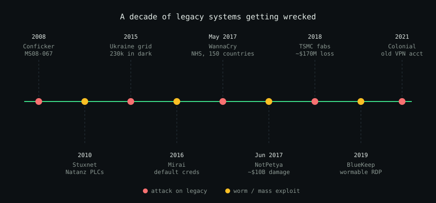

Somewhere right now, a Windows XP machine is running a multi-million-dollar MRI scanner. A PLC older than you is opening valves at a water plant. A bank is moving billions through COBOL code written in the 1970s.

None of these machines get security updates anymore. Most never will. And attackers know exactly where to find them.

These are the **zombie machines**: dead to their vendors, still alive on production networks. This post covers why they're so dangerous, who they've already wrecked, and why industry keeps them running anyway.

> **TL;DR**
>
> - Legacy systems never get patched, so every known bug stays open **forever**.
> - One leaked NSA exploit, **EternalBlue**, caused WannaCry and NotPetya: around **$10 billion** in damage.
> - Industry keeps legacy systems because of **cost, certification, downtime and decades-long hardware life**.
> - You can't always replace them, but you **can isolate them**.

## What Counts as "Legacy"?

Legacy doesn't simply mean "old". A system is legacy if it matches **any** of these:

- **End of Life (EOL):** the vendor no longer ships security patches.
- **Abandoned:** the vendor went bankrupt, was acquired, or killed the product.
- **Built on dead protocols:** SMBv1, Telnet, FTP, NTLMv1, SSLv3, Modbus, DNP3.
- **Nobody understands it:** the original developers are gone, and so are the docs.

Here's how fast "modern" turns into "legacy":

| System | End of support |
| --- | --- |
| Windows XP | April 8, 2014 |
| Windows 7 | January 14, 2020 |
| Windows Server 2008 | January 14, 2020 |
| Windows 10 | October 14, 2025 |

If you're still on Windows 10 without Extended Security Updates, you're already running legacy.

This isn't a niche problem. Palo Alto Networks' Unit 42 found that **83% of medical imaging devices** ran unsupported operating systems in 2020. Industrial controllers routinely stay in service for **20 to 30 years**.

## Why Legacy Is So Dangerous

### The Forever-Day Problem

A normal bug has a life cycle: it's found, patched and closed. On a legacy system, **the window never closes**.

Researchers call these **forever-days**: public bugs, often with working exploits on GitHub, that will never get a fix.

### Every Patch Is a Free Hint for Attackers

When Microsoft patches a supported Windows version, attackers compare the old and new files to see exactly what changed. That same bug usually exists in the unsupported version too.

So every Patch Tuesday is a free vulnerability report for systems that won't get the fix.

### What an Attacker Sees

| Weakness | Why it helps attackers |
| --- | --- |
| No security patches | Every known CVE stays exploitable forever |
| Old protocols (SMBv1, Telnet, FTP) | No encryption, weak or no authentication |
| Default credentials | `admin:admin` on a device nobody remembers |
| No modern defenses | No ASLR, no Credential Guard, no EDR support |
| Weak crypto (MD5, SHA-1, RC4) | Passwords and traffic can be cracked |
| Flat network | One infected box can reach everything |
| No logging | You won't even know you were breached |

## EternalBlue: The Exploit That Broke the World

If one story explains why legacy is lethal, it's **EternalBlue**.

### The Leak: An NSA Weapon Goes Public

EternalBlue was an NSA exploit for a bug in **SMBv1**, the old Windows file-sharing protocol.

- **CVE:** CVE-2017-0144, fixed in bulletin **MS17-010**
- **Patched:** March 14, 2017
- **Leaked:** April 14, 2017, by a group called **The Shadow Brokers**
- **Access needed:** just network access to TCP port 445
- **Result:** remote code execution as SYSTEM, no login, no clicks

That makes it **wormable**. One infected machine can automatically infect every vulnerable machine it can reach.

### WannaCry: 200,000 Machines in a Weekend

On **May 12, 2017**, the **WannaCry** ransomware worm used EternalBlue to hit more than **200,000 computers in 150+ countries** within days.

- **UK's NHS:** about a third of hospital trusts in England disrupted, around **19,000 appointments** cancelled, roughly **£92 million** in cost
- **Renault and Nissan:** production lines stopped
- **Telefónica, Deutsche Bahn, FedEx:** systems locked by ransom notes

The NHS was hit hard because it ran a huge estate of Windows XP and unpatched Windows 7 machines.

Things got so bad that on **May 13, 2017**, Microsoft released an emergency patch **for Windows XP**, three years after its end of life. WannaCry was finally slowed when researcher Marcus Hutchins registered a domain that acted as a kill switch. It cost **$10.69**.

### NotPetya: The $10 Billion Wiper

On **June 27, 2017**, **NotPetya** spread through a poisoned update of **M.E.Doc**, a Ukrainian accounting tool. It looked like ransomware, but it was a **wiper**: the data could never come back.

It combined **EternalBlue** and **EternalRomance** with **Mimikatz**-style password theft. So even patched machines fell once one unpatched machine leaked admin credentials. The White House put total damage at around **$10 billion**.

| Company | Industry | Reported impact |
| --- | --- | --- |
| **Maersk** | Shipping | ~$300M; ~45,000 PCs and ~4,000 servers rebuilt |
| **Merck** | Pharmaceuticals | ~$870M; vaccine production disrupted |
| **FedEx / TNT Express** | Logistics | ~$400M |
| **Saint-Gobain** | Construction materials | ~$384M |
| **Mondelez** (Oreo, Cadbury) | Food | ~$188M |
| **Reckitt Benckiser** | Consumer goods | ~£100M |

Maersk's recovery is now legend. Every domain controller it had was wiped, except one in **Ghana** that was offline due to a power cut. An employee flew that server to London to rebuild the whole company.

### TSMC: The Chip Giant That Forgot One Machine

In **August 2018**, a WannaCry variant hit **TSMC**, the world's most important chipmaker. The patch had existed for more than a year.

- **Entry point:** a supplier connected a new fab tool running **unpatched Windows 7**
- **Spread:** the worm moved across tools in several factories
- **Cost:** around **$170 million**

That's the legacy problem in one line: *one forgotten machine, one old exploit, nine-figure loss.*

### EternalBlue Never Left

Years later, EternalBlue is **still** one of the most attempted exploits on the internet. Ransomware gangs use it to move inside networks, because old SMBv1 machines are still everywhere.

## The Hall of Shame: Legacy-Killing Vulnerabilities

EternalBlue is the most famous, but it isn't alone. Each entry below follows the same format, oldest first: what it is, what it hit, and the lesson.

### Conficker (2008): The Worm That Wouldn't Die

A worm that spread through a flaw in the Windows Server service.

- **CVE:** CVE-2008-4250 (MS08-067)
- **Affected:** millions of Windows PCs, including UK, French and German military networks
- **Impact:** a decade later, it was **still** found on old medical and embedded devices
- **Lesson:** unpatched worms never really die

### Stuxnet (2010): Code That Destroyed Centrifuges

The most famous cyberweapon ever built.

- **CVE:** CVE-2010-2568 (Windows LNK flaw), plus other Windows zero-days
- **Affected:** **Siemens S7 PLCs** at Iran's **Natanz** enrichment site
- **Impact:** about **1,000 centrifuges** destroyed while operators saw normal readings
- **Lesson:** many industrial controllers trust anyone who can program them

### Heartbleed & Shellshock (2014): Bugs That Outlived Their Fix

Two famous bugs that still live in forgotten devices.

- **CVEs:** CVE-2014-0160 (Heartbleed, OpenSSL), CVE-2014-6271 (Shellshock, Bash)
- **Affected:** servers, printers, NAS boxes, network appliances
- **Impact:** stolen private keys and passwords; remote command execution
- **Lesson:** old firmware keeps old bugs, even when the fix is 10 years old

### Ukraine Grid (2015–16): Lights Out by Malware

The first confirmed cyberattacks to cut power to a country's citizens.

- **Malware:** **BlackEnergy 3** (2015), **Industroyer / CrashOverride** (2016)
- **Affected:** SCADA systems and substations of Ukrainian energy companies
- **Impact:** about **230,000 people** lost power in winter
- **Lesson:** protocols like **IEC 60870-5-104** and **IEC 61850** have no built-in login; if you can reach the device, it obeys

### Mirai (2016): Death by Default Passwords

A botnet that used no clever exploit at all.

- **Method:** tried about 60 **factory default passwords** over Telnet
- **Affected:** cameras, DVRs and home routers
- **Impact:** took down **Dyn** DNS, and with it Twitter, Netflix, Reddit and GitHub
- **Lesson:** default credentials are a vulnerability on their own

### TRITON (2017): Attacking the Safety Systems

Malware aimed at the systems that stop a plant from exploding.

- **Target:** **Schneider Electric Triconex** safety systems
- **Affected:** a **Saudi Arabian petrochemical plant**
- **Impact:** the first known malware built with the potential to kill people
- **Lesson:** even safety systems run on old firmware with weak protection

### BlueKeep (2019): RDP's Nightmare

A wormable bug in **Remote Desktop Protocol (RDP)** that needs no login.

- **CVE:** CVE-2019-0708
- **Affected:** Windows XP, Vista, 7, Server 2003 and Server 2008
- **Impact:** close to a million internet-facing machines were vulnerable at disclosure
- **Lesson:** Microsoft feared "the next WannaCry" and again patched **dead** systems

### Ripple20 & URGENT/11 (2019–20): Bugs Inside the Bugs

Bugs inside tiny network libraries shipped in other companies' products.

- **CVEs:** CVE-2020-11896 and 18 more (Ripple20), CVE-2019-12256 and others (URGENT/11)
- **Affected:** **hundreds of millions** of devices, from infusion pumps to UPS units
- **Impact:** remote code execution on embedded devices
- **Lesson:** many vendors no longer exist, so these devices **can't** be fixed

### Log4Shell (2021): The Hidden Dependency

Not legacy software itself, but legacy **dependencies**.

- **CVE:** CVE-2021-44228
- **Affected:** old Java apps and appliances with Apache **Log4j** buried inside
- **Impact:** unauthenticated remote code execution
- **Lesson:** companies spent months just **finding** where Log4j was

### Quick Reference: Every CVE in One Table

| Name | CVE / ID | Component | Impact |
| --- | --- | --- | --- |
| EternalBlue | CVE-2017-0144 | SMBv1 | Wormable RCE |
| BlueKeep | CVE-2019-0708 | RDP | Wormable RCE |
| Conficker | CVE-2008-4250 | Server service | Wormable RCE |
| Stuxnet LNK | CVE-2010-2568 | Windows Shell | RCE via USB |
| Heartbleed | CVE-2014-0160 | OpenSSL | Key theft |
| Shellshock | CVE-2014-6271 | Bash | Command execution |
| Zerologon | CVE-2020-1472 | Netlogon | Instant domain admin |
| Ripple20 | CVE-2020-11896 | Treck TCP/IP | Embedded RCE |
| Log4Shell | CVE-2021-44228 | Log4j | Unauthenticated RCE |



## Beyond Ransomware: Real-World Legacy Failures

Legacy doesn't only fail through hackers. Sometimes it just collapses under its own weight.

| Incident | Year | What went wrong | Impact |
| --- | --- | --- | --- |
| **Equifax** | 2017 | Unpatched Apache Struts (CVE-2017-5638) in an old dispute portal | ~147M people's data stolen; up to $700M settlement |
| **Colonial Pipeline** | 2021 | Unused VPN account, still active, no MFA | Largest US fuel pipeline shut for days; $4.4M ransom |
| **US nuclear command** | until 2019 | Ran on an IBM Series/1 with **8-inch floppy disks** | Flagged by a 2016 GAO report |
| **Southwest Airlines** | 2022 | Aging crew scheduling system failed in a storm | ~17,000 flights cancelled; over $1B cost |
| **FAA NOTAM system** | 2023 | Damaged file in a decades-old system | First US nationwide ground stop since 9/11 |

## Why Industry Still Runs Legacy Systems

So why not just upgrade everything? Because the people running these systems aren't careless. They're trapped. Here are the eight biggest reasons.

### 1. The Machine Costs Millions, the PC Costs $500

An MRI scanner costs **$1 to $3 million**. The Windows XP PC driving it costs a few hundred dollars.

But the imaging software only runs on that old OS. Replacing the PC means replacing the **whole machine**. The same goes for CNC mills, chip fab tools and lab analyzers.

### 2. Certification Freezes the Software

Medical devices are approved by regulators like the **FDA** in one exact setup. Aircraft and plant safety systems (like **IEC 61511**) work the same way.

Changing the OS can mean **re-certifying the entire device**. That takes years and costs a fortune.

### 3. Downtime Costs More Than the Risk

A car factory can lose **millions per hour** when a line stops. A refinery or hospital ICU can't reboot for Patch Tuesday.

Many plants get **one maintenance window a year**. Touching a controller that works feels riskier than leaving it alone.

> "If it isn't broken, don't touch it" is the most expensive sentence in cybersecurity.

### 4. Industrial Hardware Lasts Decades

Office IT is replaced every **3 to 5 years**. Industrial equipment like PLCs and SCADA servers is expected to last **15 to 30 years**.

A controller installed in 2005 is still mid-career. The software around it is long dead.

### 5. Vendor Lock-In and Vanished Vendors

Many systems depend on one vendor's hardware, drivers and protocols. If that vendor drops the product or shuts down, there's **no upgrade path at all**.

### 6. Banks Run on Code Older Than Their Programmers

Reuters reported about **220 billion lines of COBOL** still in use in 2017. It powers around **43% of banking systems** and **95% of ATM swipes**.

Rewriting it is a multi-year, billion-dollar gamble. In 2020, US states like New Jersey even begged for COBOL programmers to keep unemployment systems running.

### 7. Nobody Knows How It Works Anymore

Decades of undocumented fixes and custom logic live inside these systems. The original developers have retired.

Migrating means reverse engineering your own company. One mistake can break payroll, billing or production.

### 8. The Risk Is Invisible Until It Isn't

A replacement project costs real money **today**. A breach is a **maybe** tomorrow.

Until something like WannaCry happens, legacy risk never shows up on a balance sheet.

## How to Survive Legacy Systems

You often can't remove legacy systems right away. But you can stop them from becoming the door into everything else.

1. **Know what you have.** Build a full inventory, including OT and medical devices, with OS versions and EOL dates.
2. **Segment ruthlessly.** Put legacy devices in their own zones, following the **Purdue model** and **IEC 62443**.
3. **Kill dead protocols.** Disable **SMBv1**, block ports **445** and **3389** at the edge, and replace Telnet and FTP with SSH and SFTP.
4. **Use virtual patching.** Let IPS rules block known exploit traffic, like EternalBlue, in front of unpatchable systems.
5. **Lock it down.** Use application allowlisting, block USB, and replace every default password.
6. **Control remote access.** Use jump hosts with MFA, and disable stale VPN accounts (Colonial Pipeline's mistake).
7. **Buy extended support.** Microsoft's **Extended Security Updates (ESU)** buy time for systems like Windows 10.
8. **Monitor closely.** OT-aware network monitoring can catch strange traffic to PLCs early.
9. **Plan the exit.** Put EOL dates in contracts and budget the replacement before a crisis does it for you.

### Check Your Own Network

Find hosts with SMB open, then test them for MS17-010. Only scan networks you're authorized to test.

```bash
# Find hosts with SMB open, then run the MS17-010 check
nmap -p 445 --open 10.0.0.0/24 -oG - | awk '/445\/open/{print $2}' > smb-hosts.txt
nmap -p 445 --script smb-vuln-ms17-010 -iL smb-hosts.txt
```

On Windows, check whether SMBv1 is on, and turn it off:

```powershell
# Is SMBv1 enabled?
Get-SmbServerConfiguration | Select-Object EnableSMB1Protocol

# Turn it off
Set-SmbServerConfiguration -EnableSMB1Protocol $false -Force
Disable-WindowsOptionalFeature -Online -FeatureName SMB1Protocol -NoRestart
```

## Final Thoughts: The Past Still Runs Your Network

Legacy systems aren't really a technology problem. They're a **business, regulation and history problem** that shows up as a security incident.

EternalBlue was patched in March 2017. WannaCry still hit in May. NotPetya still caused $10 billion in damage in June. TSMC still lost $170 million in 2018. And in 2026, attackers are **still** scanning for it.

The exploit isn't the scary part. The scary part is how long we keep giving it something to hit.

So go look at your network. Somewhere in there is a machine nobody has touched in ten years. It's still running, still connected, and someone is already looking for it.

## Further Reading

- [Microsoft Security Bulletin MS17-010](https://learn.microsoft.com/en-us/security-updates/securitybulletins/2017/ms17-010)
- [CISA: Bad Practices (use of unsupported software)](https://www.cisa.gov/stopransomware/bad-practices)
- [Wired: The Untold Story of NotPetya, the Most Devastating Cyberattack in History](https://www.wired.com/story/notpetya-cyberattack-ukraine-russia-code-crashed-the-world/)
- [UK National Audit Office: Investigation: WannaCry cyber attack and the NHS](https://www.nao.org.uk/reports/investigation-wannacry-cyber-attack-and-the-nhs/)
- [Microsoft guidance on BlueKeep (CVE-2019-0708)](https://www.microsoft.com/en-us/msrc/blog/2019/05/prevent-a-worm-by-updating-remote-desktop-services-cve-2019-0708/)

---

*Running legacy systems you're worried about, or spotted a mistake in this post? [Reach out](/#contact).*
